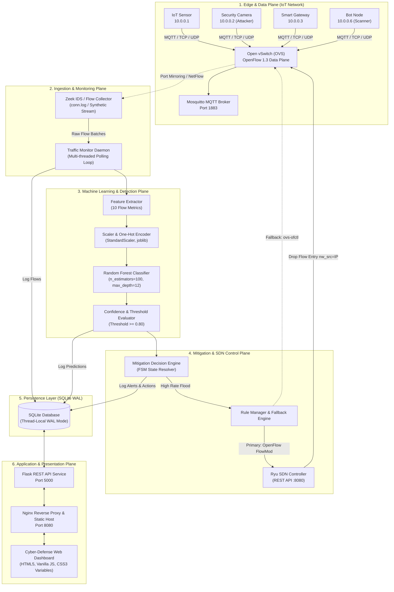
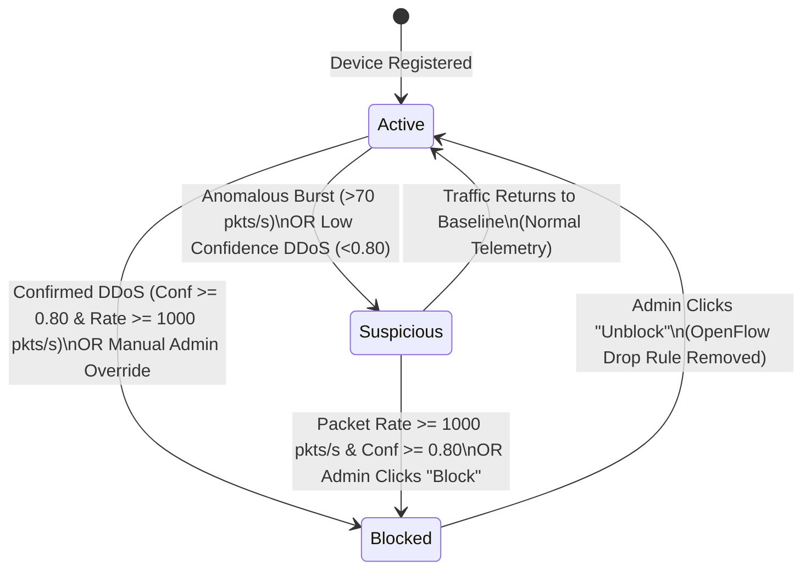
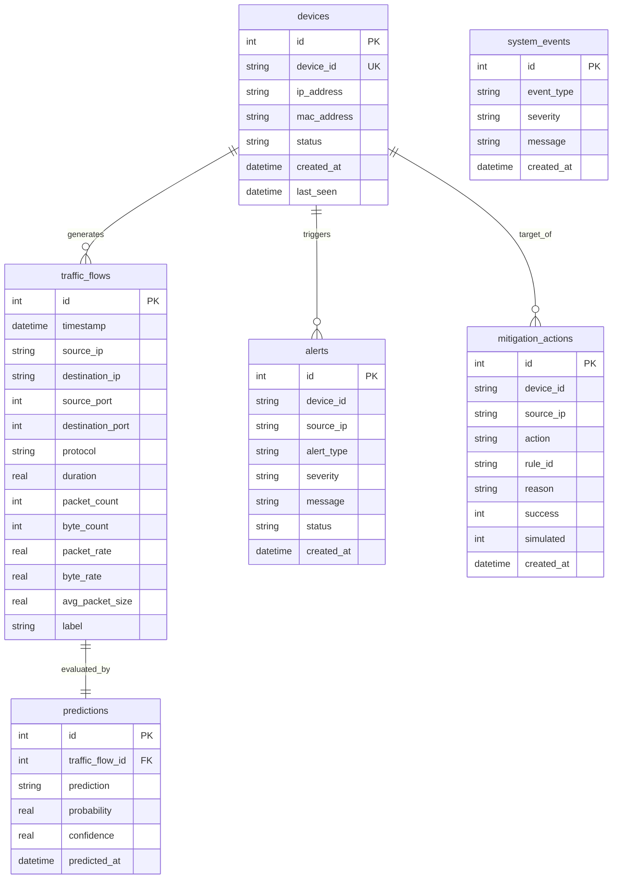

# Technical Architecture Specification
## IoT DDoS Detection & Automated SDN Mitigation System

> **Document Version:** 2.0  
> **Status:** Production-Ready Academic Architecture  
> **Target Audience:** Systems Engineers, Security Analysts, Academic Evaluators, and Developers  

---

## 1. System Overview & Architectural Goals

The **IoT DDoS Detection & Mitigation System** is an end-to-end cybersecurity solution designed to protect resource-constrained Internet of Things (IoT) ecosystems from volumetric Distributed Denial of Service (DDoS) attacks (such as Mirai-style SYN floods, UDP amplification, and botnet port-scanning).

### Core Architectural Objectives
1. **Low Latency Detection:** Classify network flows within milliseconds of ingest using an optimized Random Forest machine learning classifier.
2. **Deterministic SDN Enforcement:** Implement wire-speed packet filtering at the network ingress by dynamically injecting OpenFlow 1.3 drop rules into Open vSwitch (OVS) via the Ryu SDN Controller.
3. **Two-Tier Mitigation FSM:** Distinguish between anomalous telemetry (suspicious state) and confirmed high-rate flood attacks (blocked state) to eliminate false-positive device outages.
4. **Hardware-Agnostic Operation:** Provide unified dual-mode operation:
   - **Production / Lab Mode:** Full Mininet SDN network emulation with Ryu controller and Open vSwitch.
   - **Demo / Standalone Mode:** Microservice architecture simulating synthetic flow metrics and SDN enforcement in containerized environments without requiring Linux kernel network virtualization.
5. **Real-Time Visual Observability:** Centralized cyber-defense dashboard providing instant KPI monitoring, flow time-series graphing, threat tracking, and manual intervention controls.

---

## 2. High-Level System Architecture

The following diagram illustrates the layered architecture and communication protocols across all system tiers:



---

## 3. Subsystem Breakdown

### 3.1 Edge & Network Plane (Data Plane)
* **IoT Nodes:** Emulated or virtual nodes running MQTT clients, telemetry sensors, and network sockets.
* **Open vSwitch (OVS):** High-performance multi-layer virtual switch acting as the network's data plane switch (`br0`).
* **MQTT Broker (Eclipse Mosquitto):** Lightweight publish/subscribe messaging infrastructure communicating telemetry across IoT nodes over port `1883`.

### 3.2 Ingestion & Feature Engineering Plane
* **Zeek Integration:** Monitors bidirectional network connections and outputs structured connection records (`conn.log`).
* **Feature Extraction Engine ([`monitoring/feature_extractor.py`](file:///e:/MidSemProject/iot-ddos-filtering/monitoring/feature_extractor.py)):** Transforms raw packet counters and timestamps into normalized feature vectors:
  - `duration`: Connection lifespan in seconds.
  - `packet_count`: Total packets transmitted.
  - `byte_count`: Total volume transferred.
  - `packet_rate`: Packets per unit time ($\frac{\text{packets}}{\max(\text{duration}, 0.001)}$).
  - `byte_rate`: Bytes per unit time ($\frac{\text{bytes}}{\max(\text{duration}, 0.001)}$).
  - `avg_packet_size`: Mean payload size per packet.
  - `protocol`: Transport protocol (TCP, UDP, ICMP).

### 3.3 Machine Learning Inference Engine
* **Model Architecture:** Scikit-Learn `RandomForestClassifier` trained with 100 estimators, entropy/gini criterion, and balanced class weights.
* **Validation & Preprocessing:** Inputs are validated for non-negativity and finite numerical bounds, normalized using fitted `StandardScaler` transformations, and evaluated via `predict_proba()`.
* **Inference Output:** Produces discrete classification (`NORMAL` vs `DDOS`), probability distribution, and confidence metric.

### 3.4 Mitigation Decision Engine & State Machine
The system avoids trigger-happy or false-positive blocking by maintaining a **Three-State Finite State Machine (FSM)**:



1. **Active State:** Normal device operation with standard packet delivery.
2. **Suspicious State:** Assigned when a device displays port scanning, abnormal packet frequency (>70 pkts/s), or low-confidence anomaly predictions. The system logs an alert and highlights the node on the UI, but does **not** sever network connectivity.
3. **Blocked State:** Triggered when confidence meets or exceeds `DETECTION_THRESHOLD` (0.80) and traffic exceeds volumetric flood thresholds (`MIN_PACKET_RATE_THRESHOLD` = 1000 pkts/s), or upon manual operator intervention.

### 3.5 SDN Control Plane (Enforcement)
* **Ryu SDN Controller ([`ryu/ddos_controller.py`](file:///e:/MidSemProject/iot-ddos-filtering/ryu/ddos_controller.py)):** Communicates with Open vSwitch via OpenFlow 1.3 protocol.
* **Flow Modification (FlowMod):** When an IP is blocked, Ryu posts a flow entry:
  - **Match Condition:** `eth_type = 0x0800` (IPv4), `ipv4_src = <Offending_IP>`
  - **Priority:** `100` (overrides default forwarding flow of priority `0` or `1`)
  - **Instruction / Action:** Empty action list (`DROP`)
* **OVS CLI Fallback ([`network/ovs_manager.py`](file:///e:/MidSemProject/iot-ddos-filtering/network/ovs_manager.py)):** If Ryu REST is unreachable, direct system fallback via `ovs-ofctl add-flow br0 priority=100,ip,nw_src=<IP>,actions=drop` ensures zero mitigation downtime.

---

## 4. End-to-End Sequence Workflows

### 4.1 DDoS Attack Detection & Automated Mitigation Flow

```mermaid
sequenceDiagram
    autonumber
    actor Attacker as Compromised IoT Device (10.0.0.2)
    participant OVS as Open vSwitch (Data Plane)
    participant Monitor as Traffic Monitor Daemon
    participant ML as Random Forest Model
    participant Engine as Decision Engine
    participant Ryu as Ryu Controller / OVS CLI
    participant DB as SQLite DB (WAL)
    participant UI as Dashboard Web UI

    Attacker->>OVS: Volumetric Flood Burst (5,000 pkts/s)
    OVS->>Monitor: Capture Flow Telemetry Batch
    Monitor->>DB: INSERT INTO traffic_flows
    Monitor->>ML: predict_single(flow_features)
    ML-->>Monitor: prediction="DDOS", confidence=0.98, prob=0.99
    Monitor->>DB: INSERT INTO predictions
    Monitor->>DB: INSERT INTO alerts (severity="HIGH")
    Monitor->>Engine: evaluate(source_ip="10.0.0.2", confidence=0.98, rate=5000)
    
    rect rgb(255, 230, 230)
    Note over Engine, Ryu: Mitigation Triggered (Rate >= 1000 & Conf >= 0.80)
    Engine->>Ryu: install_block_rule("10.0.0.2")
    Ryu->>OVS: OFPFlowMod (priority=100, nw_src=10.0.0.2, actions=DROP)
    Engine->>DB: INSERT INTO mitigation_actions (action="BLOCK")
    Engine->>DB: UPDATE devices SET status='blocked' WHERE ip='10.0.0.2'
    end

    Attacker--xOVS: Subsequent Flood Packets Dropped at Switch!
    UI->>DB: Poll /api/metrics & /api/traffic/flows (Every 2s)
    UI-->>UI: Traffic Chart Plunges to Baseline; "Blocked IPs" Counter = +1
```

---

## 5. Database Schema & Entity-Relationship Model

The system utilizes an optimized SQLite relational database operating with write-ahead logging (`PRAGMA journal_mode=WAL`) and a 30-second busy timeout for high-concurrency read/write operations.



---

## 6. Docker Containerization Architecture

The system is fully containerized across three isolated microservices governed by Docker Compose:

```
┌─────────────────────────────────────────────────────────────┐
│                    Docker Host Environment                  │
│                                                             │
│   ┌───────────────────────────┐                             │
│   │   iot-ddos-frontend       │  Nginx 1.25 Alpine          │
│   │   Port: 8080:80           │  Static SPA + Proxy Cache   │
│   └─────────────┬─────────────┘                             │
│                 │ Reverse Proxy (/api/* -> backend:5000)     │
│                 ▼                                           │
│   ┌───────────────────────────┐                             │
│   │   iot-ddos-backend        │  Python 3.11 Slim           │
│   │   Port: 5000:5000         │  Flask + SQLite + Scikit-ML │
│   └─────────────┬─────────────┘                             │
│                 │ TCP (MQTT Telemetry)                      │
│                 ▼                                           │
│   ┌───────────────────────────┐                             │
│   │   iot-ddos-mqtt           │  Eclipse Mosquitto 2.0      │
│   │   Port: 1883:1883         │  Lightweight MQTT Broker    │
│   └───────────────────────────┘                             │
│                                                             │
│   Shared Volumes:                                           │
│   - ddos_db_data -> /app/data (SQLite database persistence) │
└─────────────────────────────────────────────────────────────┘
```

---

## 7. Security, Resilience & Failure Modes

1. **Thread-Safe Concurrency:** Connection-per-request pattern implemented via Python `threading.local()` ensures that background monitoring threads and incoming HTTP API requests never encounter SQLite locking conflicts.
2. **Graceful SDN Degradation:** If the Ryu REST controller is offline or unresponsive, the rule manager automatically falls back to direct Open vSwitch kernel commands (`ovs-ofctl`). In pure demo environments, it automatically falls back to software-simulated drops, ensuring uninterrupted dashboard operation.
3. **No Blind Auto-Blocking:** By decoupling low-rate anomalies into the `suspicious` status and reserving immediate automatic blocking for high-confidence volumetric floods ($\ge 1000$ pkts/s), the system prevents Denial of Service against legitimate devices.
4. **Audit Trail Logging:** Every block, unblock, or classification decision is persisted to both `mitigation_actions` and standard security log channels (`security.log`).

